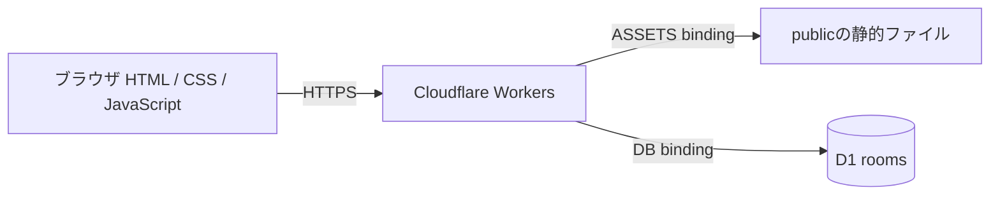

# 1on1目標・タスク管理アプリ 詳細設計書

作成日：2026-11-15  
対象：ローカルのコミット d5b3f74。現行実装の説明であり、新規変更の指示ではない。

## 1. 構成



本番WorkerはWeb標準APIを使う。Node http/fs/sqliteをWorkerへ持ち込まない。
旧ブラウザ版はlocalStorage、従来のローカルサーバー版はNode.js＋SQLiteを利用する。

## 2. モジュール

| ファイル | 責務 |
|---|---|
| landing.html / landing.js | 基本情報入力、ルーム作成、発行リンク表示 |
| index.html / style.css | 画面構造、静止SVGを含む装飾 |
| shared-app.js | 共有版の描画、操作、ロール制御、未保存管理 |
| domain.js | 入力検証、進捗、目標・タスク操作、履歴 |
| http-repository.js | API通信と変更コマンドの保持 |
| worker/entry.js | default handlerのみを公開する起動入口 |
| worker/index.js | API・本文検証・静的配信・応答ヘッダー |
| worker/d1-repository.js | トークン照合、D1アクセス、競合検出 |
| worker/rules.js | 許可フィールド、操作コマンド、サーバー側業務検証 |
| worker/errors.js | 例外のHTTP応答への変換 |
| worker/room-html.js | 既存HTMLを共有版へ変換 |
| app.js / repository.js | localStorageの旧試作 |
| server.mjs / server-repository.mjs | ローカルHTTPサーバーとSQLite保存 |
| tools/build-assets.mjs | 公開用9ファイルのコピー・許可リスト検証 |

保存処理をRepositoryで分離する。共有版UIは業務操作を捕捉し、変更コマンドとして送信する。
サーバーはクライアントから任意の履歴や権限情報を受け取って上書きする方式ではない。

## 3. 画面・ルート

| パス | 内容 |
|---|---|
| / | 基本情報・ルーム作成 |
| /room | トークンで編集／閲覧を判定する共有画面 |
| /demo | ブラウザ保存を使う旧試作 |

共有画面は基本情報、取り組み中、達成済み、履歴タブ、編集者向け共有管理で構成する。
閲覧時は入力と完了チェックを無効化し、変更・共有管理のボタンを非表示にする。
画面制御だけでなくAPI側でも更新を拒否する。

## 4. DBとデータモデル

### 4.1 roomsテーブル

```sql
CREATE TABLE IF NOT EXISTS rooms (
  id TEXT PRIMARY KEY,
  state TEXT NOT NULL,
  edit_hash TEXT NOT NULL UNIQUE,
  view_hash TEXT NOT NULL UNIQUE
);
```

ルームごとに1行。stateはJSON文字列、両hashは共有トークンのSHA-256。
目標・タスク・履歴を別テーブルに正規化していない。revisionはJSON内の値でありSQLカラムではない。
schema.sqlは参考定義。既存本番へ自動適用しない。

### 4.2 stateの要素

| 要素 | 主なフィールド |
|---|---|
| AppState | schemaVersion=1、revision、profile、goals、snapshots |
| Profile | memberName、joinedMonth、latestMeetingDate |
| Goal | id、title、dueDate、status、continuationEditEnabled、achievedAt、revision、tasks |
| Task | id、title、dueDate、priority、completed |
| Snapshot | id、meetingDate、recordedAt、profile、experience、goals、goalProgress |

statusはactive / achieved、priorityはlow / medium / high。
SnapshotはstructuredCloneによる独立コピー。experienceは実施日時点の年月数、goalProgressは記録時の目標ID別進捗。

### 4.3 日付・計算

- 今日の基準はAsia/Tokyo。日付YYYY-MM-DD、年月YYYY-MM。
- 業界歴は年差×12＋月差を年月に分解。負数を防ぎ、入力の時系列も検証する。
- 進捗はMath.round(完了数÷総数×100)。0件なら0。
- 達成条件は1件以上の全件完了。丸めた率で判定しない。
- 未完了かつ期限が今日より前なら期限切れ。

## 5. トークンと権限

1. Web Cryptoで32バイトの乱数を生成し、43文字のbase64urlへ変換する。
2. SHA-256の16進ハッシュだけをD1へ保存する。
3. 作成時に編集／閲覧リンクを別々に返す。リンクの秘密部分はfragmentに含める。
4. 画面はfragmentをタブ単位のsessionStorageへ保持し、URLから取り除く。
5. APIにはAuthorizationのBearerヘッダーで送る。
6. サーバーがハッシュを照合してedit / viewを判定する。

再発行はedit / view / both。DB更新成功後、対象の旧トークンは失効する。
編集トークン更新時は現在の画面も新しいトークンへ切り替える。
トークンは認証資格情報に相当する。ハッシュから原文を復元する機能はない。

## 6. API

JSON応答はUTF-8。APIはOriginがあれば自身のoriginと比較し、cross-siteの操作も拒否する。

| メソッド／パス | 権限 | 主な入力 | 成功応答 |
|---|---|---|---|
| POST /api/rooms | トークン不要 | profile | 201：state、role、tokens |
| GET /api/state | edit / view | Authorization | 200：state、role |
| POST /api/save | edit | expectedRevision、profile、commands | 200：更新stateなど |
| POST /api/record | edit | expectedRevision、overwrite | 200：更新stateなど |
| POST /api/remove | edit | expectedRevision、gid | 200：更新stateなど |
| POST /api/links | edit | expectedRevision、kind | 200：更新state、発行tokensなど |

保存コマンド：addGoal、addTask、editTask、deleteTask、editGoal、deleteGoal、achieve、continueGoal。
1回の保存は最大200コマンド。許可フィールドとID形式を制限し、サーバーで業務ルールを再検証する。
本文は262,144バイトまで。JSONのContent-Type、本文の存在、UTF-8、JSON構文を検証する。

## 7. 保存・競合検出

1. トークンと編集権限を検証する。
2. expectedRevisionと読み込んだstateのrevisionを比較。不一致は409。
3. stateのコピーへ操作を適用し、全体を検証してrevisionを増やす。
4. 次の単一SQLで条件付き更新する。

```sql
UPDATE rooms SET state=?, edit_hash=?, view_hash=?
WHERE id=? AND state=? AND edit_hash=? AND view_hash=?;
```

5. 更新件数1なら成功。0なら競合または失効を確認する。

revision事前検証後に別の保存が入った場合も、stateと両hashの比較で上書きを防ぐ。
編集トークンが競合中に失効していれば、再照合で401を返す。
WorkerへNode SQLiteのBEGIN/COMMITをそのまま移植していない。

## 8. 状態遷移・履歴

| 操作 | 条件と結果 |
|---|---|
| タスク完了 | 通常状態では未完了だけを操作可能 |
| 最後のタスク完了 | 達成確認を表示。まだ自動移動しない |
| 達成 | 全件完了を検証しachievedと達成日を設定。継続編集を解除 |
| 継続・再開 | active、継続編集可能。既存の完了状態は保持 |
| 達成済みから再開 | 取り組み中の空き枠が必要 |
| 履歴記録 | 保存済みstateをコピー。同日分を置換し、実施日順に最新3回を保持 |
| 達成済み削除 | 達成日より後の実施日で、同じ目標の最新revisionを達成済みとして記録済みであること |

履歴記録と古い回の間引きは新JSONの単一UPDATEで確定する。失敗時は旧行を維持する。
現在の目標削除はコピー済み履歴へ連鎖しない。ただし履歴自体は最新3回の保持制限を受ける。

## 9. エラー

| HTTP状態 | 条件 |
|---|---|
| 400 | 本文・UTF-8・JSON・フィールド・操作などの形式不正 |
| 401 | トークンなし、不正、再発行済み |
| 403 | 閲覧による更新、異なるサイトからの操作 |
| 404 | 未定義API、配信対象外ファイル |
| 405 | 静的配信への許可されないメソッド |
| 409 | revision・更新状態の競合 |
| 413 / 415 | 本文サイズ超過／Content-Type不正 |
| 422 | 上限・完了ロックなどの業務ルール違反 |
| 503 | 保存先・配信先の不備、予期しないインフラ障害 |

UIは入力を保持し、失敗を成功扱いにしない。競合の自動統合はしない。
インフラ例外は一般的な文面にし、SQL・state・hash・秘密・内部トレースを応答やconsoleへ出さない。

## 10. 配信・表示・安全性

- 公開は許可リストの9ファイルのみ。publicに想定外のファイルがあればビルドを停止する。
- DB、開発資料、設定、テストをWeb配信しない。
- ASSETS内部取得へAuthorization・Cookie・クエリを渡さない。
- no-store、no-referrer、nosniff、CSPを付与する。
- SQLはバインドし、ユーザー入力のHTML表示はエスケープなどを行う。
- 画面は暗い青、細い枠、小さな静止SVG、読みやすい本文を使用する。
- 動画背景、大きな追加UIライブラリ、常時動く雨を使わない。

## 11. 環境・公開

| 項目 | 内容 |
|---|---|
| 本番設定 | wrangler.jsonc、入口worker/entry.js |
| DB接続 | DB binding。DBパスワードをフロントへ渡さない |
| 静的配信 | ASSETS binding、public、run_worker_first有効 |
| ローカル | wrangler.local.jsonc、本番とは別名のローカルD1 |
| 依存管理 | package.jsonとlock。lockのWranglerは4.158.0 |
| CI/CD | Workers Builds、main、build: npm run worker:assets、deploy: npx wrangler deploy --config wrangler.jsonc |

公開URL：https://task-management-api.renaito008.workers.dev/
認証はWrangler／Cloudflare側で管理する。トークンをコードや資料へ含めない。
現行設定ではログ収集を無効化。機密を避けた監視は今後の検討事項。
公開と自動デプロイ成功は開発時の記録による。今回の再疎通はしていない。

## 12. テスト・品質・未確認事項

| テスト群 | 件数 |
|---|---:|
| 業務ルール・保存境界 | 9 |
| Nodeサーバー | 8 |
| Worker・D1互換・移行など | 11 |
| 起動入口 | 1 |
| 更新helper | 1 |
| 合計 | 30 |

過去に30件成功。今回は再実行していない。
D1互換テストはNode SQLiteによるテストアダプターであり、実D1の全件検証ではない。
独立レビュー用プロンプトはあるが、網羅的な独立人手レビュー完了の記録は未確認。
現行Build commandはテスト必須実行ではない。
実D1自動テスト、負荷・性能測定、復元訓練、レート制限、機密を避けた監視は改善候補。
既存DBの移行、Git履歴書き換え、アプリ変更はこの文書作成では行わない。

## 13. 関連資料

- [要件定義書](01_REQUIREMENTS.md)
- [使用マニュアル](03_USER_MANUAL.md)